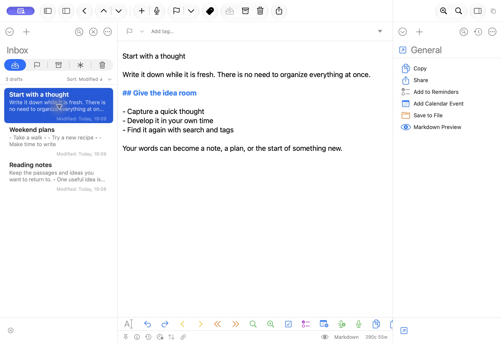

# Draftly

A native Mac app to capture ideas, develop your writing, and put your words
to work with actions.

**[Download for Mac](https://draftly.pobrespandas.com/)** ·
[User guide](docs/getting-started.md) ·
[Explore actions](https://draftly.pobrespandas.com/actions.html)

Requires **macOS 26 or later**. Draftly has one edition, with no Pro feature tier.

[](website/public/draftly-editor-0.1.2.jpg)

*Actual Draftly 0.1.2, shown with sample content.*

## What you can do

- Capture a quick thought in the editor or the separate Capture window.
- Find drafts with search, tags, flags, and saved workspaces.
- Write in Markdown and open the integrated preview.
- Personalize the editor with fonts, themes, spacing, and shortcuts.
- Run actions to copy, share, export, or connect your writing to other tools.
- Review earlier versions and export a full library backup.

## Install and get started

1. [Download the DMG](https://draftly.pobrespandas.com/).
2. Open it and drag Draftly to Applications.
3. Open Draftly and press **⌘N** to start writing.

The public app is signed and notarized. You do not need Xcode or an Apple
Developer membership. To update, choose **Draftly → Check for Updates…**.
Draftly asks before installing an update.

The [user guide](docs/getting-started.md) explains capture, search, organization,
Actions, personalization, and backups.

## Current status

Draftly is in development. The released app has been checked for installation,
updates, basic editing, and retention of a test draft and preferences on the
test Mac. This is not a
claim that every function or integration is complete.

Compatibility with Drafts actions is still in progress. Imported scripts can
need changes or services that are not available on a given Mac. Read the
[compatibility guide](docs/compatibility.md) for the specific limits.

This version is for Mac. iPhone, iPad, Apple Watch, MCP, and email capture are
outside the current scope. See [project progress](docs/project-progress.md)
for implemented work and checks that remain open.

## Build from source

For a local development build, use macOS 26 or later and Xcode 26 or later
with Swift 6.2 or later:

```sh
scripts/build-app.sh --local
```

Open `.build/xcode/Build/Products/Debug/Draftly.app`.
This build uses local storage and does not configure iCloud.

The [development guide](docs/development.md) covers signing, iCloud development,
tests, library formats, and the repository structure. Public release builds
have separate [release requirements](docs/releasing.md).

## Find the right documentation

- **Using the app:** [User guide](docs/getting-started.md).
- **Changing the code:** [Development](docs/development.md),
  [testing](docs/testing.md), and [architecture](docs/architecture.md).
- **Publishing a version:** [Release operations](docs/releasing.md) and
  [CI/CD](docs/ci-cd.md).
- **Understanding the product:** [Product direction](PRODUCT.md) and
  [constitution](CONSTITUTION.md).
- **Finding other references:** [Documentation index](docs/README.md).

See [LICENSE](LICENSE) for the license.
